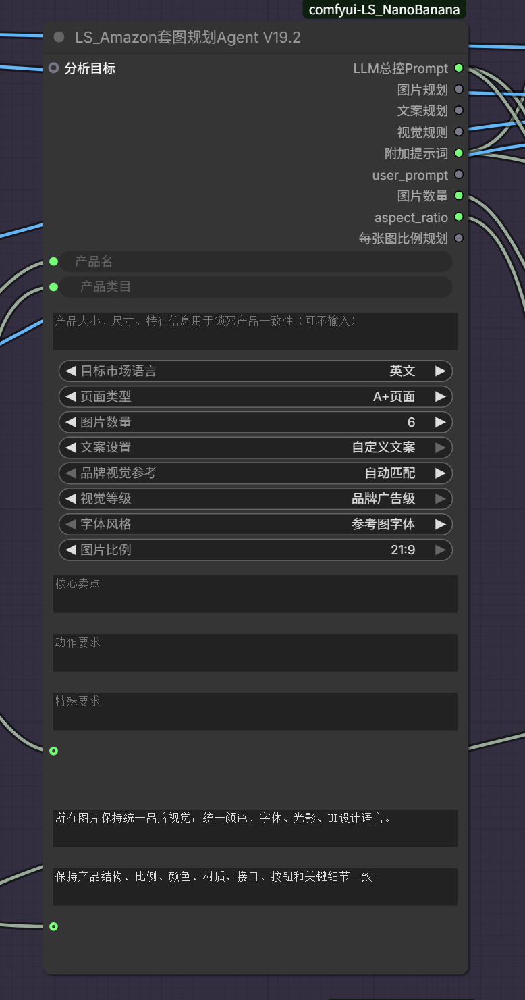

# ComfyUI LS NanoBanana

**产品图 + 统一参考图 → 自动规划 → 一组视觉一致的商业图片。**

English: ComfyUI nodes for product-reference image generation, unified-reference advertising sets, visual analysis and prompt planning. This repository distributes a **CPython 3.13 bytecode runtime**, not the editable source edition.

  

## 功能展示

### LS_Amazon套图规划Agent V19.2



根据产品信息、视觉分析与用户文案，统一规划产品套图的图片内容、文案、视觉风格和生图提示词。

| 参数 | 作用 |
| --- | --- |
| 产品名、产品类目、产品特征 | 确定规划对象并锁定产品一致性 |
| 目标市场语言、页面类型 | 确定画面文案语言与页面方向 |
| 图片数量、图片比例 | 设置套图数量和画幅 |
| 文案设置、品牌视觉参考 | 确定文案模式与品牌方向 |
| 视觉等级、字体风格 | 统一商业视觉和字体体系 |
| 核心卖点、动作要求、特殊要求 | 补充本次规划需求 |
| 整套视觉统一锁、产品一致性锁 | 保持整套风格与产品外观一致 |

输出包括 LLM 总控 Prompt、图片规划、文案规划、视觉规划、附加提示词、user_prompt、图片数量、aspect_ratio 和每张图比例规划。

## 安装

本发布版要求 **CPython 3.13**，本机使用 3.13.11 验证。其他 Python 小版本不能直接加载这些 `.pyc` 文件。

在 `ComfyUI/custom_nodes` 目录执行：

```bash
git clone https://github.com/diyibaak/ComfyUI-LS-NanoBanana.git
python -m pip install -r ComfyUI-LS-NanoBanana/requirements.txt
```

这里的 `python` 必须是启动 ComfyUI 的 Python。PyTorch 使用 ComfyUI 已有环境。安装后重启 ComfyUI、刷新页面。

如果原来已经安装 `comfyui-LS_NanoBanana`，请先备份并将旧目录移出 `custom_nodes`，再安装本仓库，避免相同节点 ID 被加载两次。

## 先运行简化示例

1. 将 [示例图片](examples/assets/) 复制到 `ComfyUI/input`，或在加载图像节点中上传自己的图片。
2. 导入 [统一参考简化版工作流](examples/unified_reference_simple.json)。
3. 在 `LS_一键套图（统一参考简化版）` 填写自己的 API Key，替换需求与文案。
4. 默认一张产品图、一张参考图；需要多图时启用处于旁路状态的可选加载节点。
5. 运行后从保存图像节点查看结果，输出保存在 `ComfyUI/output`。

图片数量范围为 1～20，分辨率选项为 1K、2K、4K；实际可用模型、尺寸和费用由服务商决定。参考图不会作为产品外观依据。定稿文案逐字保留，“不需要文字”模式不显示广告文案。

## API 与配置

此插件需要第三方接口账号，**不是离线生图插件**。当前生图和简化流程针对 `www.lsaigc.xyz` 渠道实现；不能保证任意 OpenAI 兼容服务商直接可用。仅配置 `api_base_url` 不会改变 `LS_NanoBananaPro` 内固定的生图域名。

首次加载会从 `config.example.ini` 生成 `config.ini`，为规划接口设置与生图渠道一致的默认域名，不覆盖已有配置。推荐直接在节点填写 API Key；也可以编辑本地 `config.ini`。`config.ini` 已被 Git 忽略，请不要提交密钥或带密钥的工作流。

## 自动补跑规则

- GPT HTTP 408、429、500、502、503、504、连接建立超时以及特定上游 `Invalid value for 'image'` 拒绝会按现有逻辑重试。
- 已返回任务 ID 时先查询原任务；该任务明确 `failed` 且符合上述上游图片错误时才重新提交。
- 默认等待 10、20、40 秒；保留原提示词、参考图、模型、尺寸和种子，补跑不重做同批已成功条目。
- 队列中或运行中的任务、查询状态不明、读取超时、连接中断，以及鉴权/余额/普通参数错误，不自动创建新任务。
- 重试耗尽时可能仍有失败卡片；不保证上游可用，也不保证服务商对失败请求不收费。

## 全部节点

| 注册 ID | 显示名称 |
| --- | --- |
| `LSAmazonPresetNode` | LS_亚马逊套图生成预设 |
| `LSAmazonSetPlanningAgent` | LS_Amazon套图规划Agent V19.2 |
| `LSAmazonSimpleSet` | LS_一键套图（统一参考简化版） |
| `LSAmazonTextOverlay` | LS_Amazon统一字体叠字 |
| `LSAmazonVisualAnalysisAgent` | LS_电商视觉分析Agent V2.9 |
| `LSCompetitorAdPlanner2Call` | LS_竞品卖点图规划_2次调用V1 |
| `LS_FloatSlider` | LS_浮点滑条 |
| `LS_FloatSlider2D` | LS_双浮点滑条 |
| `LS_ImageStitch` | LS_图像拼接 |
| `LS_LLMReverseNode` | LS_LLM多模型反推 V3 |
| `LS_LLMReverseNodeLegacy` | LS_LLM多模型反推 V3（旧版） |
| `LS_LatentRatioPicker` | LS_图像尺寸预设 |
| `LS_NanoBananaPro` | LS_Nano Banana |
| `LS_PromptSplitter` | LS_提示词分割器 |
| `LS_TextJoin` | LS_文本联结器 |
| `MaskFillHoles` | LS_遮罩填补漏洞 |

## 版本与验证

当前版本 `0.1.0`：套图规划 V19.2、视觉分析 V2.9、统一参考简化节点。保留节点 ID，清理重复旧版运行文件。

发布前验证字节码导入、节点输入输出、单图/多图工作流校验及自动补跑模拟测试。图片接口未作为本次发布验证进行收费调用。界面示例与输入插图不代表实际收费生成效果。

`.pyc` 是编译字节码，**不是严格加密**，也不是跨 Python 版本的发布格式。可编辑源码与原始本机配置没有包含在本仓库。
